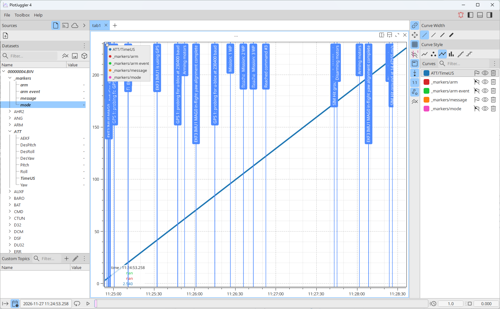
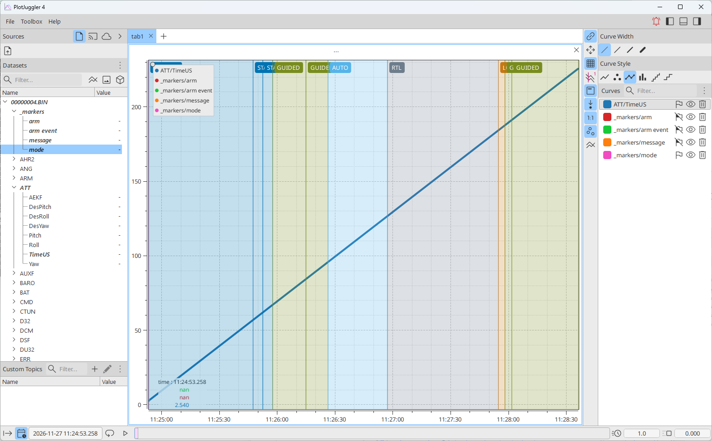
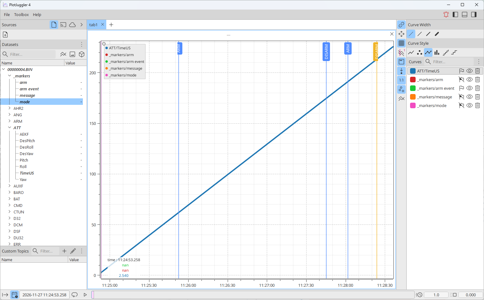
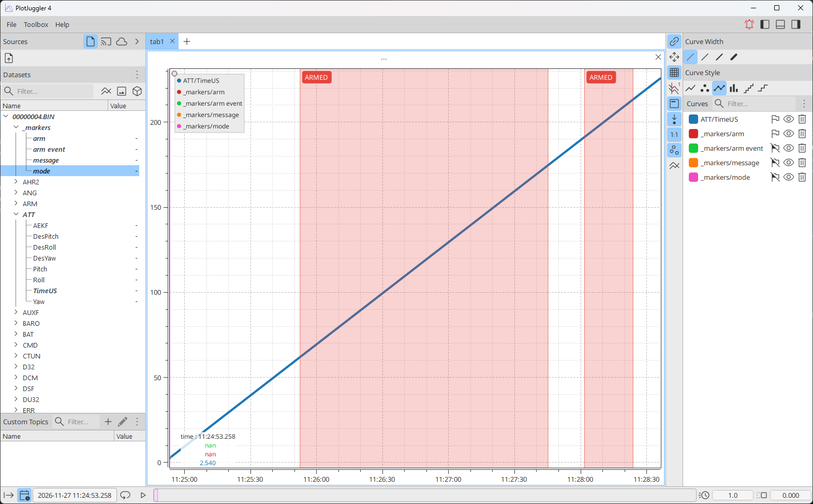

# Plot markers

Besides the numeric series, the loader publishes the log's messages, flight modes and arm/disarm state as **plot
markers**: annotations drawn on top of a plot, aligned with the time axis.

## Using them

Markers live on a topic called `_markers`. Each field of it is a placeholder series (all NaN, so it draws no curve and
does not affect the axis range) that carries a marker set. To see a marker set, **drag its field onto a plot**. To
show or hide the markers of a curve, click the **marker icon**  in the curves list
(not the eye icon , which shows or hides the curve itself).

A field only exists when the log has at least one marker of that kind.

| Field | Source | Marker |
|---|---|---|
| `_markers/message` | `MSG` | Label or Event per message |
| `_markers/mode` | `MODE` | Region per flight mode |
| `_markers/arm event` | `ARM` | Event per arm / disarm |
| `_markers/arm` | `ARM` | Region per armed span |

## Marker types

### Message — `_markers/message`

One marker per flight message (`MSG`), at the time it was logged, with the message text as its label. Most logs do
not record a message level, so the markers are shown with the normal info look. Only when the log has a `Severity`
field is the marker colored by level: critical for MAVLink levels 0-2, error for 3, warning for 4, and the info look for
notice, info and debug.

### Flight mode — `_markers/mode`

A shaded region per flight mode (`MODE`), labeled with the mode name. A region lasts until the next mode change; the last one runs to the end of the log.
Each mode number keeps one color through the whole log, taken from a palette of 8 colors without red (red is the arming
color). Mode numbers 8 apart share a color; the label tells them apart.

### Arm / disarm event — `_markers/arm event`

An event at each arm (`ARM`) and disarm (`DISARM`). A forced change is shown as a warning. Repeated `ARM` rows of the
state the vehicle is already in are ignored.

### Armed span — `_markers/arm`

A red region labeled `ARMED` from each arm to the following disarm. A span still open when the log ends runs to the end
of the log.
